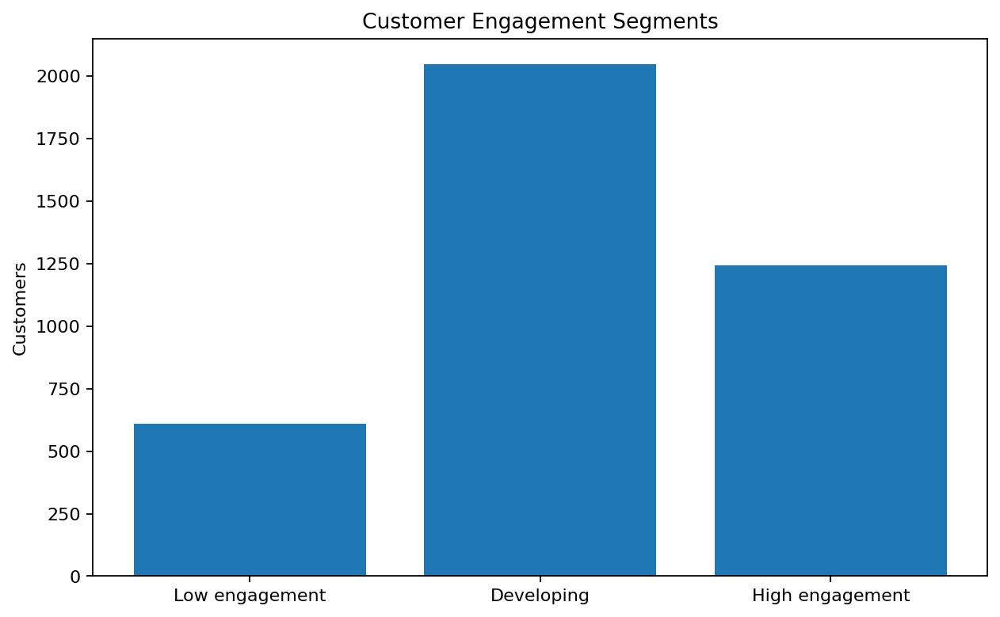

# Customer Retention & Segmentation Analytics

Exploratory analysis and **behavior-based customer segmentation** of 3,900 shopping customers. The project examines spending, purchase history, self-reported purchase frequency, and subscription status to develop actionable loyalty insights.

> **Scope:** This dataset is a customer snapshot, not a dated transaction log. The project studies *retention indicators*, not observed retention/churn rates. It does **not** calculate true RFM recency, customer lifetime value, or cohort retention.

## Dataset

- Source: `data/raw/Dataset.csv` (provided project dataset)
- Shape: 3,900 rows × 18 columns
- Unit of observation: one customer per row
- Fields include demographics, item/category, observed purchase amount, subscription status, previous purchases, and reported purchase frequency.
- 37 missing review ratings are imputed with the median for analysis.

## Workflow

1. Inspect source columns, missingness, and duplicates.
2. Clean field names and impute missing review ratings.
3. Explore customer spending and product category distributions.
4. Convert purchase-frequency labels to a frequency proxy.
5. Score spending, previous purchases, and frequency in quartiles (1–4 each).
6. Sum scores (3–12) and assign **Low engagement (3–5)**, **Developing (6–8)**, **High engagement (9–12)**.
7. Compare subscription rates and purchasing patterns across segments.
8. Review recommendations and methodological limitations.

## Run locally

```bash
python -m venv .venv
# macOS/Linux:
source .venv/bin/activate
# Windows PowerShell:
# .venv\\Scripts\\Activate.ps1
pip install -r requirements.txt
python src/analysis.py
jupyter notebook notebooks/customer_analysis.ipynb
```

Run `python src/analysis.py` from the repository root or any directory; the script resolves paths relative to itself. Generated tables are in `data/processed/`, plots and findings in `reports/`.

## Results

See [analysis findings](reports/findings.md) for computed segment counts, metrics, figures, and interpretation.



## Repository layout

```text
customer-retention-segmentation/
├── data/
│   ├── raw/Dataset.csv
│   └── processed/
├── notebooks/customer_analysis.ipynb
├── src/analysis.py
├── reports/
│   ├── findings.md
│   └── figures/
├── requirements.txt
├── .gitignore
└── README.md
```

## Ethical and analytical caveats

- Spending is the amount observed in the row, not lifetime spend.
- Segments are descriptive heuristics, not a churn classifier.
- Frequency labels are approximate; different labels can map to the same annualized proxy.
- Quartile rank tie-breaking is deterministic but can split equal values.
- No dates, follow-up outcomes, or observation window exist to calculate actual retention or churn.
- Review data rights and permissions before publishing the raw dataset publicly.

## Potential next steps

Obtain timestamped transactions and customer join dates to compute real retention/cohorts and recency; evaluate segmentation stability and campaign outcomes.
