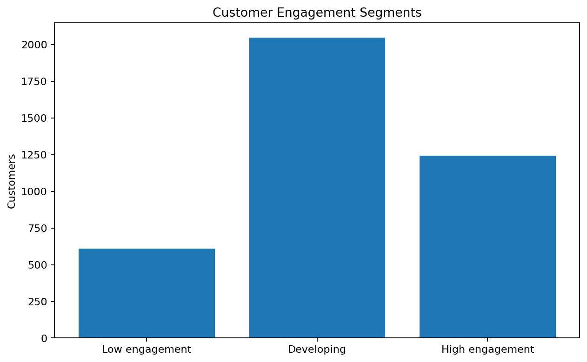
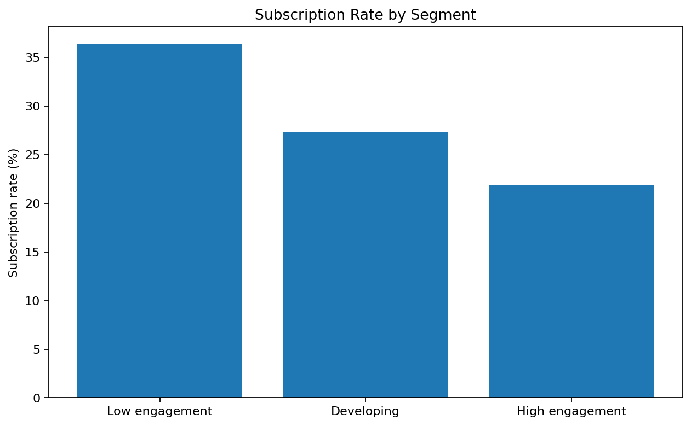
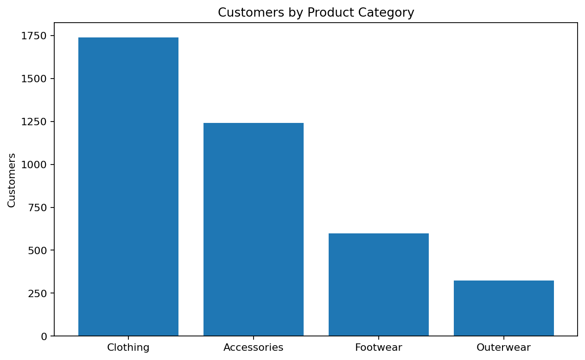
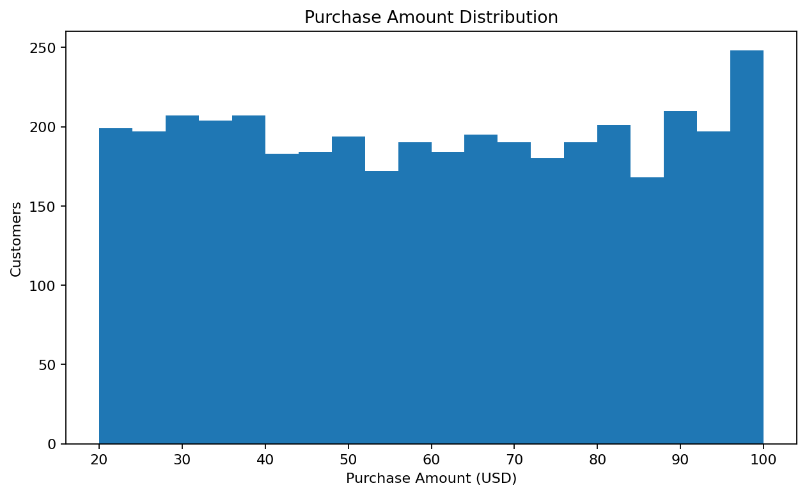

# Analysis Findings

## Dataset metrics

- **Customers:** 3,900.00
- **Total Observed Purchase Usd:** 233,081.00
- **Average Observed Purchase Usd:** 59.76
- **Subscription Rate:** 0.27
- **Missing Review Ratings In Raw:** 37.00

## Segment summary

| segment         |   customers |   avg_purchase_usd |   avg_previous_purchases |   subscription_rate |   avg_engagement_score |
|:----------------|------------:|-------------------:|-------------------------:|--------------------:|-----------------------:|
| Low engagement  |         611 |              39.49 |                    13.03 |                0.36 |                   4.50 |
| Developing      |        2047 |              56.58 |                    23.33 |                0.27 |                   7.04 |
| High engagement |        1242 |              74.99 |                    34.74 |                0.22 |                   9.73 |

## Interpretation and limitations

- Each row is one customer with one observed purchase amount. Summing this field is the sum of recorded amounts, **not customer lifetime revenue**.
- Engagement segments are rule-based descriptive groups, not validated predictions of churn.
- Previous purchases and reported frequency are proxies for engagement; the data has no transaction dates, last purchase dates, or observation windows.
- **Actual retention rate, churn rate, cohort analysis, and RFM recency cannot be calculated** from this dataset.
- Annualized frequency is an ordinal-like proxy from reported labels, not verified annual transaction counts.
- Segmentation uses row-order tie breaking in quartiles, which can separate customers with equal source values.

## Suggested actions

- High engagement: prioritize loyalty recognition and tailored offers.
- Developing: test targeted cross-sell and subscription messaging.
- Low engagement: test re-engagement campaigns; do not label these customers as confirmed churned.

## Visualizations

